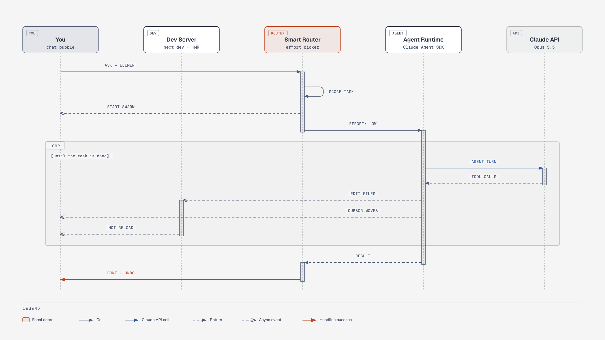

# Hivebubble: build plan

> **Talk to your website. Watch the hive build it.**
> An open-source Mac app that puts a Claude-powered chat bubble on your localhost site, so anyone can build, deploy and run a custom web app without opening an editor or a terminal.

Draft v0.1 · 2026-11-20 · Facts about the Claude Agent SDK and similar tools were checked on this date (sources at the end).

---

## 0. The short version

You open a project folder in Hivebubble, or start from a template. Hivebubble installs what's needed, starts the site on localhost, and adds a chat bubble in the bottom-right corner of the page, like the support bubbles on websites.

You type what you want: *"make the pricing cards bigger"*, *"add a sign-up form that saves to a database"*. A swarm of cursors moves over the real page while Claude edits the code, and the page updates live. When it's ready, a deploy wizard with illustrated options puts it online. A **Users & Data** screen lets you ask questions about your users in plain English and change their data safely.

Behind the scenes, a **Smart Router** picks Claude's effort level, the skills to load and how much checking to do for each request, so every task finishes as fast as it can without getting worse.

---

## 1. Name: Hivebubble

- **A hive of busy bees, working inside your chat bubble.** The bubble is where you talk, and the hive is the swarm of agents that builds what you asked for.
- **The swarm cursors are the bees.** That gives you a mascot for reels, stickers and the app icon. It also suggests a visual language (honeycomb shapes, a soft buzz when work starts) and makes the animation memorable instead of generic. Settings keeps a plain-cursor option for people who prefer it.
- It's easy to say and spell, doesn't sound like a coding tool (good for a non-tech audience), and gives you post lines: "the hive is building", "let the bees do it".
- **Checked on 2026-11-20:**
  - `hivebubble.com` is unregistered (Verisign whois).
  - The GitHub user/org name `hivebubble` and the npm package name `hivebubble` are free.
  - No GitHub repo uses the name.
  - A web search found no product called Hivebubble.

  **Do next, today:**
  - Register `hivebubble.com`.
  - Create the `hivebubble` GitHub org.
  - Grab the X and Instagram handles (not checked here, because those sites need a login).
  - Run a quick trademark search before the public announcement.
- **Other names checked and dropped:**
  - Murmur and Elfwork: taken (`elfwork.com` was registered in 2025).
  - Sayso: a voice-dictation app.
  - Swarmly, Wishcraft, Antwork, Hivewright: used by other small projects.
  - **Backups that were also free on `.com`, GitHub and npm:** Bubblewright, Tinkerswarm, Buildpixie.

---

## 2. Who it's for, and what it isn't

**For:**
- Founders with an idea and no developer.
- Small business owners who want a custom tool instead of a generic SaaS.
- Designers and marketers who have a project a developer started and want to change it themselves.
- Developers who want a faster loop for visual changes (a secondary audience).

**The promise:** no editor, no terminal, no "run `npm install`". Your code stays on your Mac, and you own it.

**Not:**
- A hosted app builder. Hivebubble is local and open source.
- A Cursor replacement for developers.
- A tool for cloning other companies' products (see §14).

---

## 3. What already exists, and how Hivebubble is different

| Tool | What it does | Hivebubble's angle |
|---|---|---|
| **stagewise** | Open-source toolbar injected into a localhost app through a CLI proxy (`npx stagewise`). You click elements and its agent edits the code. AGPL-3.0. | **Closest match.** The difference is no terminal at all (the Mac app starts everything), a design for non-developers, the effort router, automatic skill installs, and deploy plus user data in the same app. Don't copy its code into a MIT or Apache repo, because AGPL code can't be relicensed that way. |
| **Onlook** | Figma-like visual editor for React and Next.js, aimed at designers. | Hivebubble is chat-first, not canvas-first. |
| **Lovable, Bolt, v0, Replit Agent** | Hosted, browser-based app builders. | Hivebubble is local and open source: your files and your key, and it works on projects you already have. |
| **Cursor, Claude Code** | Editors and CLIs for developers. | Hivebubble hides the editor completely. |
| **Swarm Rebuild** (Chrome extension) | The multi-cursor "agents are building" effect that inspired this. | Hivebubble's cursors are driven by the agent's **real** tool calls, so the animation is also an honest progress bar. |

Re-check this table before launch, because this space moves every month.

---

## 4. Architecture


*Source: [`docs/diagrams/architecture.html`](docs/diagrams/architecture.html) (open it in a browser). It was drawn with [diagram-design](https://github.com/cathrynlavery/diagram-design) using the default skin, so re-skin it once Hivebubble has brand colors.*

The big zone is the Hivebubble app on your Mac. What each box does:

1. **Your Site + bubble** (in the browser). An injected script renders a widget inside a Shadow DOM, so the site's CSS can't break the widget and the widget can't break the site. It holds three things: the chat panel, the element picker, and the cursor layer.
2. **Preview Proxy.** A local reverse proxy in front of the dev server. For HTML responses it injects `<script src="/__hivebubble/bubble.js">`. Everything else, including the dev server's hot-reload WebSocket, passes through untouched. It also hosts the WebSocket that connects the bubble to the app.
   - *Why a proxy:* it works with any framework and any browser, there's no extension to install, and the user's code doesn't change.
   - *Gotchas to handle:* compressed responses (ask the dev server for uncompressed output, or decompress), streamed SSR (inject at the end of the stream), CSP headers (relax them in the dev proxy only), and absolute URLs that point at the dev server's port.
3. **Smart Router.** Picks effort, model, skills, context and checks for every message. See §6.
4. **Agent Runtime.** A Node sidecar running the **Claude Agent SDK** (TypeScript). For each task it:
   - runs with `cwd` set to the project folder;
   - uses the `effort` and `model` the router chose;
   - turns every tool call into a cursor event through hooks (`PreToolUse` / `PostToolUse`);
   - saves an undo point with `enableFileCheckpointing` and `rewindFiles()`;
   - turns risky actions into plain-language yes/no cards through `canUseTool`.
5. **Dev Server.** Started by Hivebubble. It's detected from `package.json` (Next.js, Vite, Astro, Remix, SvelteKit, …), its logs are translated into plain English, and it restarts automatically after a crash.
6. **Project Folder.** The user's code. Hivebubble adds `.hivebubble/` (project map, router log, skills lock file) and `.claude/skills/` (installed skills).
7. **Skills + Starters.** The curated registry, plus discovery on skills.sh and GitHub. See §8.
8. **Claude API.** Called with the user's own API key. See §13.
9. **Hosting + Database.** Deploy targets and the user's data. See §9 and §10.

**App screens** (inside the Hivebubble window): Projects · Live (dev server status and logs) · Skills · Deploy · Users & Data · Settings.

---

## 5. One message, start to finish



*Source: [`docs/diagrams/message-flow.html`](docs/diagrams/message-flow.html)*

1. **Ask.** You type in the bubble. If you picked an element first, its selector, source location (`file:line`) and a screenshot crop go with the message.
2. **Score.** The router classifies the task in under 100 ms, using rules and no LLM call (see §6).
3. **Start the swarm.** The bubble starts the cursor animation right away, so you see a reaction in under a second.
4. **Plan.** The router hands the agent the effort level, the skills, the exact files to look at, and the "done" checks.
5. **Loop.** The agent calls Claude, runs tools and edits files. Every tool call moves a cursor, and every saved file hot-reloads the page.
6. **Check.** Hivebubble runs the checks the router chose (none, typecheck, build or visual check). If a check fails, the router retries **once** at one effort level higher.
7. **Done.** The bubble gives a one-sentence summary of what changed and shows an **Undo** button (the checkpoint from step 4).

**Speed targets to measure** (these are goals, not promises): router decision under 100 ms, first cursor move under 1 s, a copy or color tweak finished in about 15 s.

---

## 6. The Smart Router: the "super smart" part

**Goal:** the best result in the shortest time, at a sensible cost.

### What it decides for every message

| Decision | Options | Notes |
|---|---|---|
| **Effort** | `low` · `medium` · `high` · `xhigh` · `max` | Set it through the Agent SDK `effort` option. Always set it explicitly: Opus 5.5's default is `medium`. |
| **Model** | Claude Opus 5.5 by default | Changing effort on one model is the first lever, and keeping one model keeps the prompt cache warm. Only test Sonnet 5.5 for trivial edits if measurements show it's faster at the same quality. |
| **Skills** | The 1–3 relevant ones | Loading fewer skills means fewer tokens and faster turns. |
| **Context** | The picked element's `file:line` and the project map | The agent shouldn't spend turns searching for files. |
| **Checks** | none · typecheck · build · visual check | A text change doesn't need a full build. |

### How it decides

1. **Rules (instant, free).** Signals include: words in the message (`color`, `text`, `add a page`, `login`, `database`, `error`), whether an element was picked, whether there's an error or stack trace, the estimated number of files involved (from the picked file's imports and the project map), whether it touches risky areas (`package.json`, schema, auth, payments, `.env`), whether this is a new empty project, and whether the last attempt at this task failed or was undone.
2. **Tie-breaker call (only when the rules aren't sure).** One short low-effort call with a structured output: `{task_type, files_estimate, risk, needs_question}`. If `needs_question` is true, the bubble asks the user one question before starting.
3. **Learning.** Every task is logged locally: signals, effort, tokens, time, cost and outcome. A task counts as a success when the checks pass, the user doesn't press Undo within a few minutes, and there's no "that's wrong" follow-up. Thresholds get tuned from this log. Later, users can opt in to sharing anonymous logs, which would become an open dataset and community-tuned defaults (good build-in-public material).

### Starting table (tune with real data)

| Request | Example | Effort | Checks |
|---|---|---|---|
| Copy or text change | "change the headline to …" | `low` | none (hot reload shows it) |
| Style tweak on a picked element | "make this button rounder" | `low` | typecheck if a `.tsx` file changed |
| New section or component | "add a testimonials section" | `medium` | typecheck + lint |
| Feature with data or auth | "save sign-ups to a database" | `high` | build + smoke test |
| Bug with an error | "the page is blank, here's the error" | `high` | build + reload check |
| New app from a starter, or a big refactor | "make me a booking app" | `xhigh` | full build + visual check |
| Retry after a failed attempt | — | one level up, **once** | previous checks + the one that failed |
| `max` | never automatic | — | only from a "Think harder" button |

**User control:** a three-way switch with plain words, **Quick / Balanced / Thorough**, that moves the whole table one level down or up.

### Speed levers besides effort

- Give the agent the exact `file:line` of the picked element, so it never searches.
- Keep a project map in `.hivebubble/map.json` (routes, components, data models) and refresh it when files change.
- Keep the system prompt and the tool list stable so prompt caching hits. Watch the cache-read token counts. If changing effort between turns of one session breaks the cache, start a fresh session per task with a short summary.
- Use parallel subagents only for big tasks with independent parts, because they cost more tokens.
- **Optional "Turbo" toggle:** fast mode on Opus 5.5 (`speed: "fast"`) gives up to 2.5× faster output at 2× the price. It's a Messages API parameter, so check whether the Agent SDK exposes it before promising it.

### The router needs its own test set

Collect 30–50 real prompts across the table rows, each with a small "done" check. Run every router change against them and compare time, cost and pass rate. That gives you the real numbers for your posts.

---

## 7. Swarm cursors

**They move because the agent is actually working.** In Hivebubble the cursors are small bees, the project's mascot.

- **Where the events come from:** Agent SDK hooks send `{agent, tool, file, lines}` to the bubble through the proxy's WebSocket.
- **From a file to an element on the page:** a dev-only build plugin stamps `data-hivebubble-src="src/components/Hero.tsx:14"` on JSX elements (the same idea as LocatorJS and click-to-component). A cursor can then fly to the element whose code is being read or edited. The plugin never runs in production builds.

| Agent event | What the cursor does |
|---|---|
| Reads or searches a file | Hovers over that file's elements with a "reading" ripple |
| Edits or writes a file | Clicks in, shows a typing caret and a shimmer on the element, then a small ✓ after hot reload |
| Runs a command (install, build) | Walks to a "workbench" tray in the bubble that shows the command in plain words |
| Starts a subagent | A new named bee joins (Designer, Builder, Checker) |
| Waits on Claude | Cursors idle with a gentle "thinking" bob |
| Hits an error | The cursor turns amber and points at the problem |

- **Files with no element on the page** (API routes, config): the work shows in the workbench tray.
- **Rules:** never fake progress. Animate only with `transform` and `requestAnimationFrame`, respect `prefers-reduced-motion`, and keep the overlay at `pointer-events: none` except for the bubble.
- **Element picker:** hover to highlight, click to attach. After that, "change this" just works.

---

## 8. Skills and starter repos

- **Format:** Agent Skills, which are folders containing a `SKILL.md`. The Agent SDK loads them from the project's `.claude/` folder when `settingSources` includes `'project'`.
- **Hivebubble's own skills**, shipped with the app:
  - `hivebubble-house-style`: clean code per framework (small files, typed, accessible, no dead code).
  - `hivebubble-verify`: what "done" means at each router level.
  - `hivebubble-explain`: plain-language summaries for non-technical users.
- **Registry:** `registry/skills.json` and `registry/starters.json` live in the Hivebubble repo. Every entry is curated and records its commit SHA, license, last-reviewed date and what it's for. The community adds entries by PR, which gives newcomers easy first contributions.
- **Discovery beyond the registry:** skills.sh, Anthropic's skills repo and GitHub search (filtered to a permissive license and recent commits). Results from these sources are labeled **"not reviewed"** and installed only after the user approves.
- **Lock file:** `.hivebubble/skills.lock` records the source, the SHA, and which task installed each skill.
- **Skills screen:** lists installed skills, why each was installed, the source link and version, and has buttons to update (with a diff) and remove.
- **Safety:** a third-party skill is instructions, and sometimes scripts, that the agent will follow, so it carries both prompt-injection and supply-chain risk. To manage it: pin SHAs, never auto-update, show the diff on every update, flag skills that include scripts or network calls, and give reviewed entries a "verified" badge.
- **Starters:** for "make me a booking app", the router picks a starter from the registry. Its license must allow reuse (MIT, Apache or BSD; GPL and AGPL obligations get flagged to the user). Hivebubble copies it without its git history, installs dependencies and then adapts it.

---

## 9. Deploy wizard

- **Illustrated cards**, one per target, each showing who it's best for, the free tier, the number of steps and a time estimate. The router pre-selects the best fit for the project's stack.
- **Targets, in order:** Vercel (best for Next.js), Netlify, Cloudflare Pages and Workers, then Railway or Render for apps with a server. Supabase covers the database and auth.
- **Steps**, each one a screen with a picture and one sentence:
  1. Pick a card.
  2. Connect the account (OAuth or a token, stored in the Keychain).
  3. Check environment variables: Hivebubble lists what the app needs and what's missing.
  4. Build locally first, to catch errors before uploading.
  5. Deploy, with the same cursor animation streaming progress.
  6. Show the live URL and a QR code.
  7. Optional: set up a custom domain, with step-by-step DNS illustrations.
- Check each provider's CLI and API flags at build time, because they change.

---

## 10. Users & Data

- **Connect:** Supabase and any Postgres URL first, Firebase later. Connections are **read-only** by default.
- **Ask in plain English.** For example, *"Who signed up this week?"* or *"Which users never finished onboarding?"* Hivebubble answers with a table or chart, and a collapsible "how I got this" box shows the generated SQL.
- **Change data safely.** For a request like *"Give Priya pro access"*, Hivebubble shows a proposed-change card with:
  - the rows affected (a count and a preview);
  - a before/after diff;
  - an automatic backup of those rows;
  - a **Confirm** button.

  A bulk delete needs a typed confirmation word, and Undo restores the backup.
- **Logs:** pull deploy, function and error logs from the hosting provider and auth logs from the database. Hivebubble summarizes errors in plain English, links each one to the code that caused it, and offers to fix it from the bubble.
- **Privacy:** user data goes to Claude only when it's needed to answer a question. There's an option to mask emails and phone numbers before sending. Hivebubble stores nothing off the Mac, and the app says this in plain words.

---

## 11. Tech stack

| Part | Pick | Why | Alternative |
|---|---|---|---|
| App shell | **Tauri v2** | The Mac app now, Windows and Linux later from the same code. Small app size. The UI is web tech, which the bubble already uses. | SwiftUI: the best Mac feel, but a rewrite for every other platform |
| App UI and bubble | React + TypeScript + Tailwind. The bubble is bundled by Vite into one script and rendered in a Shadow DOM. | Shares components between the app and the bubble | Svelte, for a smaller bubble bundle |
| Core daemon | TypeScript on Node, shipped as a sidecar binary | One language for the router, proxy, deploy and data code. The Agent SDK has a TS version. | Python Agent SDK |
| Agent | **Claude Agent SDK** (`@anthropic-ai/claude-agent-sdk`) | Comes with Claude Code's tools, hooks, permissions, sessions, skills and checkpoints. It runs the Claude Code binary, so expect a bigger app download. | Messages API with our own agent loop (much more work) |
| Proxy | Node proxy with streaming HTML injection and WebSocket passthrough | Works with any framework | Framework plugins for Vite and Next.js later |
| Local state | SQLite for app data, JSON files in `.hivebubble/` per project | Simple and inspectable | — |
| Secrets | macOS Keychain | Never stored in plain files | — |
| Node for user projects | A Hivebubble-managed Node LTS in Application Support | Users never have to install Node | — |
| Undo | Agent SDK checkpoints, plus a bundled git or isomorphic-git | Users aren't forced to install Xcode Command Line Tools (a large download) | — |
| Monorepo | pnpm workspaces + Turborepo | Standard and fast | — |

---

## 12. Repo layout

```
hivebubble/
├─ apps/
│  ├─ desktop/        # Tauri shell + React UI: Projects, Live, Skills, Deploy, Users & Data, Settings
│  └─ site/           # landing page + docs (later)
├─ packages/
│  ├─ core/           # daemon: project manager, dev-server runner, IPC with the app
│  ├─ proxy/          # preview proxy, HTML injection, WebSocket relay
│  ├─ bubble/         # in-page widget: chat, element picker, swarm cursors
│  ├─ router/         # effort / skills / checks router + its test set
│  ├─ agent/          # Agent SDK wrapper: hooks → events, permission cards, checkpoints
│  ├─ source-tags/    # dev-only JSX transform that adds data-hivebubble-src
│  ├─ skills/         # registry client, installer, lock file
│  ├─ deploy/         # provider adapters (vercel, netlify, cloudflare, …)
│  └─ data/           # DB connectors, plain-English → SQL, safe-write flow, logs
├─ registry/          # skills.json, starters.json (community PRs welcome)
├─ skills/            # Hivebubble's own skills
├─ docs/diagrams/     # architecture + message-flow diagrams (diagram-design)
└─ README.md (this plan) · LICENSE · CONTRIBUTING.md · CODE_OF_CONDUCT.md
```

---

## 13. Claude access, keys and cost

- **Users bring their own Anthropic API key** from the Claude Console. It's stored in the Keychain.
- **Claude subscription login (Pro or Max) is not an option** for a third-party app unless Anthropic approves it. From the Agent SDK docs: *"Unless previously approved, Anthropic does not allow third party developers to offer claude.ai login or rate limits for their products, including agents built on the Claude Agent SDK."* If you want it, ask Anthropic. Don't build a workaround.
- **Branding:** "Hivebubble, powered by Claude" is fine. Don't call it "Claude Code" or copy Claude Code's look (per the Agent SDK branding guidelines).
- **Cost UX:**
  - A cost estimate before big (`xhigh`) tasks.
  - A live cost meter in the bubble.
  - A daily spending cap (default around $5) with a friendly pause screen.
  - A monthly summary.

  Keeping cost down is part of the router's job.
- Use of the Agent SDK falls under Anthropic's Commercial Terms. Read them before launch.

---

## 14. Safety and trust

Non-technical users can't judge code, so Hivebubble has to be safe by default.

- **Permissions.** Auto-approve edits inside the project folder. Everything else goes through `canUseTool` as a plain-language card, for example: *"Hivebubble wants to install `stripe`, a payments library. Allow?"* That covers files outside the project, new packages, deleting files and touching `.env`. Never use `bypassPermissions`.
- **Undo everything.** Save a checkpoint before every task, show one big **Undo** in the bubble, and keep a history list in the app.
- **Secrets.** `.env` values are never sent to the page or the bubble, keys stay in the Keychain, and logs are redacted.
- **Skills and starters:** see §8. **Database writes:** see §10.
- **Untrusted content.** Web pages, repos and skills are data, not instructions. The permission cards are the backstop if something slips through.
- **Licensing and "rebuild anything":**
  - Starters must allow reuse.
  - GPL and AGPL obligations are respected and shown to the user.
  - Hivebubble helps people build *their own* tools. It won't help reverse-engineer or clone someone else's closed product, which is a legal risk for users and for the project.
  - Reverse-engineering tools like rea stay out of Hivebubble.

---

## 15. Roadmap

Every milestone ends with something you can film.

| # | Milestone | Done when | Post / reel |
|---|---|---|---|
| **M0** | Foundations | Repo is public with a license, a README with the diagram, and CI | "I'm building an app that lets anyone build apps by talking to their website", with the architecture diagram |
| **M1** | Bubble on localhost | Open a Next.js or Vite folder, and Hivebubble installs dependencies, starts the dev server and injects the bubble. Chat edits the page at a fixed effort, and hot reload shows the change. | The first "typed one sentence, site changed" reel |
| **M2** | Swarm cursors + picker | Cursors follow real tool events, and the picker attaches `file:line` | **The hero reel:** cursors building a page |
| **M3** | Router v1 + undo + cost | Rules router, one retry on failure, checkpoints and Undo, cost meter and cap, a test set of 30 prompts | "Auto effort vs. always-max: same result, X× faster, Y× cheaper", with real numbers |
| **M4** | Skills & starters | Registry, lock file, Skills screen, "new app from a starter" | "Empty folder to working booking app" timelapse |
| **M5** | Deploy wizard | Vercel works end to end with illustrated steps, then Netlify and Cloudflare | "Localhost to a live URL in one click" |
| **M6** | Users & Data | Read-only queries on Supabase and Postgres, a logs summary, safe writes | "I asked my app who signed up today" |
| **M7** | Beyond the Mac | Windows and Linux builds, plus an optional Chrome extension that attaches to any localhost | Platform launch posts |

**Big launch** (Show HN, Product Hunt): after M3 or M4, once a stranger can install Hivebubble and get the "wow" moment within 5 minutes.

---

## 16. Build-in-public plan (X + Instagram)

- **Accounts:** a dedicated handle that matches the name on X, Instagram and GitHub.
- **Cadence:**
  - **X:** one short progress post a day (a clip or screenshot plus one line), and one thread a week (a decision and its numbers).
  - **Instagram:** 2–3 reels a week, **10–22 seconds each**, plus one carousel a week. Diagrams made with diagram-design fit carousels well (it has a `social-square` size preset).
- **Content pillars:**
  1. **Demo clips.** The swarm cursors are the hook in the first 2 seconds.
  2. **Router numbers.** Time and cost per task at each effort level.
  3. **Non-technical builders.** Give Hivebubble to a friend who can't code and film what they make.
  4. **Open-source moments.** Star milestones, the first contributor PR, merged registry entries.
  5. **Honest failures.** What broke and how you fixed it.
- **Reel formula:** hook text ("I built a website by talking to it"), then 3–4 s of typing in the bubble, then the cursor swarm, then the page changes. End on the live URL or the GitHub repo name.
- **The repo as a growth engine:**
  - a README with a 10-second GIF at the top and a one-line install;
  - `good first issue` labels, with registry entries as easy first PRs;
  - a public roadmap in GitHub Projects;
  - a changelog that doubles as post material.
- **Track weekly:** GitHub stars, downloads, followers on each platform, and the path from reel views to profile visits to repo clicks.

---

## 17. Decisions for you

1. **Name:** go with Hivebubble? Check the handles and domain first.
2. **App shell:** Tauri (recommended) or SwiftUI?
3. **License:** Apache-2.0 (recommended: adds a patent grant) or MIT (simplest)? AGPL would keep forks open but puts off companies and contributors.
4. **Claude access:** API keys only at launch, or also ask Anthropic about approval for subscription login?
5. **First frameworks for M1:** only Next.js and Vite + React?
6. **First deploy target:** Vercel?

---

## 18. First-week checklist

- [x] Create the GitHub repo and publish this plan as the README. Still to add: a license.
- [ ] Scaffold the monorepo (pnpm + Turborepo) and a Tauri app that can open a folder.
- [ ] **Spike 1:** a proxy that injects a "hello" bubble into a Next.js dev server page while hot reload keeps working.
- [ ] **Spike 2:** an Agent SDK sidecar where one prompt edits a project file and hot reload shows it. Log every hook event.
- [ ] **Spike 3:** the dev-only JSX tag plugin. Clicking an element returns its `file:line`.
- [ ] Post: a day-1 announcement with the architecture diagram.

---

## Sources (checked 2026-11-20)

- Claude Agent SDK overview: capabilities, the claude.ai login note, branding guidelines. https://code.claude.com/docs/en/agent-sdk/overview
- Claude Agent SDK TypeScript reference: `effort`, `model`, `settingSources`, `enableFileCheckpointing` / `rewindFiles()`, `hooks`, `canUseTool`, `permissionMode`. https://code.claude.com/docs/en/agent-sdk/typescript
- stagewise (YC S25): localhost toolbar plus agent. https://www.ycombinator.com/launches/O3M-stagewise-the-frontend-coding-agent-for-production-codebases
- Comparison of browser-aware coding tools (stagewise, Onlook and others). https://dev.to/bluehotdog/ai-coding-tools-that-actually-see-your-browser-2026-2hoc
- diagram-design, used for the diagrams in `docs/diagrams/`. https://github.com/cathrynlavery/diagram-design
