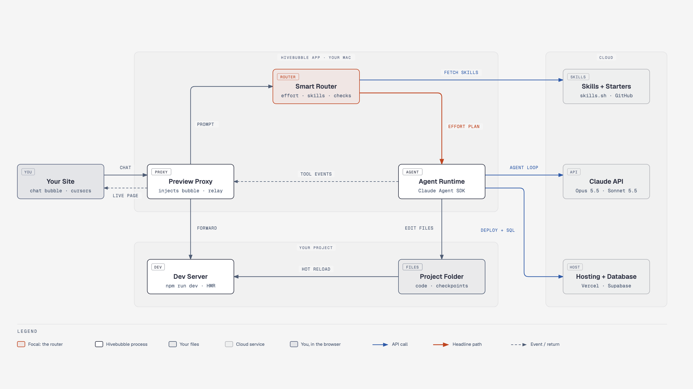

# Hivebubble

> **Talk to your website. Watch the hive build it.**
> An open-source desktop app (macOS, Windows and Linux) that puts a Claude-powered chat bubble on your localhost site, so anyone can build, deploy and run a custom web app without opening an editor or a terminal.

---

## Try it (milestones M1 to M8)

**No API key needed.** Claude Code does the work, with your own Claude login:

1. Once, add Hivebubble's plugin to Claude Code: `claude plugin install hivebubble --marketplace AryanKuAg/hivebubble` (or `/plugin install hivebubble --marketplace AryanKuAg/hivebubble` inside Claude Code).
2. Start Hivebubble on your project: the desktop app, or `pnpm start path/to/your/project`.
3. Open Claude Code in the project's folder and type `/hivebubble:work`.
4. Talk to your site in the bubble. Each request goes to Claude Code, which edits the code; the bees on the page follow its steps, Hivebubble checks the page, and Undo puts things back.

**What works today:**
- Open a JavaScript web project. Hivebubble installs its packages, starts its dev server and puts a chat bubble on the page at `http://localhost:4321`.
- Type what you want, or pick a part of the page first. Claude edits the code and the page updates live through hot reload.
- **Claude Code does the work** (M8), through Hivebubble's plugin in `claude-code/`:
  - an MCP server with `next_request`, `say` and `finish` for the bubble's requests, and `data_schema`, `data_query` and `data_change` for Users & Data;
  - hooks that tell Hivebubble each step, so the bees follow Claude Code's real reads, searches and edits. Each file is saved before it's edited (for Undo), edits inside the project are approved during a bubble request, and the bubble's **Stop** refuses Claude Code's next step;
  - the `/hivebubble:work` command, which starts the loop: wait for a request, do it, finish, wait again.

  After Claude Code calls `finish`, Hivebubble runs its checks. If one fails, the error goes straight back to Claude Code to fix, once. Hivebubble never signs in to Claude itself: it finds no key and needs none. With `--agent api` (or a key saved in the desktop app), Hivebubble's own Claude agent does the work instead, billed to that API account.
- **The picker knows where things are written.** Pick an element and the bubble shows its source location (`Hero.jsx:6`). Claude gets the exact `file:line:column` and goes straight there, without searching.
- **Bee cursors follow the agent's real steps** to the exact elements its code draws:
  - **Reading** a file: a bee tours the elements that file draws, under a blue reading ripple.
  - **Searching**: a bee scans the page, then hops to the elements where the matches are.
  - **Editing**: the bee clicks in, a caret blinks in its label and the element shimmers. A ✓ appears only once hot reload has put the change on the page. A stylesheet edit lights up the elements its rules style.
  - Code that draws nothing on the page (config, data, server code) is worked on at the **workbench** next to the hive.
  - While Claude **thinks** between steps, the bees bob in place. A **failed step** turns its bee amber at the problem, and so does the dev server's error overlay.
- The **Smart Router** picks Claude's effort and the checks for each message, in well under a millisecond and without an LLM call (§6):
  - It tells questions, text changes, style tweaks, new sections, features, bugs and new apps apart. Quoted new text doesn't count, so *change the button to "Pay now"* stays a quick text change.
  - Logins, payments, data, secrets and packages get careful effort and a build check. Asking for several things at once, or a failed or undone last attempt, moves the next task one level deeper.
  - A **Quick / Auto / Thorough** switch moves it down or up a level. **Think harder** is the only way to the deepest effort.
- **Checks after every change, and one retry.** The dev server has to compile every changed file, and the open page must show no new errors from them. TypeScript projects also get a type check, and bigger tasks a production build (Vite). Errors that were there before the task don't count (Hivebubble checks types and the build once in the background when a project opens). If a check fails, the hive tries once more, one effort level deeper, with the error in hand. If that fails too, it says so plainly.
- **Cost you can see and cap.** A live cost meter runs while Claude works. Big tasks show an estimate and wait for a yes. Hivebubble pauses for the day at a daily limit ($5 by default, set in the desktop app or with `--daily-cap`), and each task stays under a task limit ($2, `--max-budget`). The bubble and the desktop app show today's and this month's spending.
- **Undo** reverts the last change, also after a restart. It won't silently overwrite edits made after the task: it asks first.
- Every task is written to `.hivebubble/router-log.jsonl` (signals, effort, checks, cost, time, outcome, later undos). Estimates for big tasks come from it.
- **Start something new.** Say what you want ("a booking app for my salon") on the desktop app's home screen, or run `pnpm new --for "…"`. Hivebubble:
  - picks a starter (a working booking app, a small-business website, or Vite's blank React + TypeScript app);
  - copies it into a new folder without its git history, installs it and starts it;
  - waits with your request in the bubble, so Claude adapts the app to you.
- **Skills.**
  - **Built in:** Hivebubble's own skills ship as a plugin and are always available: house style, what "done" means, and explaining changes in plain words.
  - **From the registry:** reviewed skills can be added to a project. Each is pinned to a commit, with its license and the date it was read. Before a task, the router offers one that fits, once. During a task, only the skills it needs are switched on.
  - **The Skills screen** (desktop app) shows each skill's reason, version, license and files. It shows the diff before any update, and removes skills.
  - **The lock file** `.hivebubble/skills.lock` records where each skill came from and why.
- **Put it online** (the globe in the bubble's header). A wizard inside the bubble:
  1. shows a card for **Vercel**, **Netlify** and **Cloudflare**, each with who it's best for, the free plan, the steps and the time. It recommends the host you used last, or Vercel;
  2. connects the account: the desktop app keeps each host's token in the system's secure storage, and the card says how to make one;
  3. lists the settings the app reads (`import.meta.env.X`, `process.env.X`) and warns about any that no `.env` file sets. It only reads names, never values;
  4. builds the site on your computer first, so a broken build never reaches the host. If the build fails, it shows the log, and one button hands it to the hive to fix;
  5. uploads the files, with a progress bar per step and a bee on the workbench (Netlify and Cloudflare get only the files that changed);
  6. shows the live address, a QR code for your phone and the steps to add your own domain. The next deploy updates the same site.
- **Users & Data** (the database button in the bubble's header), for Supabase and any Postgres:
  - **Ask in plain words**, like *"Who signed up this week?"*. The answer comes back as a sentence and a table, or bars for counts over time. *How I got this* shows the SQL, which you can edit and run again.
  - **Claude never sees your data.** It gets your question and the names and types of your tables and columns; passwords and tokens are left out even there. The query then runs on your computer, inside a read-only transaction, with a time limit and at most 500 rows back. Password and token columns show as "hidden".
  - **Change data safely.** Ask *"Give Priya pro access"* and Hivebubble shows exactly which rows would change, before → after, and waits. On **Make this change** it saves a backup of those rows to `.hivebubble/data/backups`, checks the rows still look like the preview, and changes them in one transaction. That transaction writes the values you saw to the rows you saw; no SQL written by Claude runs in it. Deleting more than one row needs the word "delete" typed. The **Changes** tab undoes any change from its backup, and asks first if the rows were edited again since.
  - **Logs:** errors from the page, the dev server and production builds, grouped and said in plain words, with the file they point at and a **Fix it** button that hands the error to the hive. For Supabase it also shows sign-ups and sign-ins from the last 7 days.
  - A switch hides emails and phone numbers on screen and in what **Fix it** sends, for screen recordings.
  - Demo mode answers a few fixed questions about users without Claude, and never changes data.
- The bubble's connection only accepts the page Hivebubble serves: other websites, and pages that reach your computer under another name (DNS rebinding), are refused.
- The **desktop app** runs on macOS, Windows and Linux. It keeps your API key, hosting tokens and each project's database connection string in the system's own secure storage (the Keychain, Windows Credential Manager, or the Secret Service keyring on Linux), remembers recent projects and shows your spending and daily limit.
- **The Chrome extension** (`apps/extension`) puts the bubble on localhost pages that Hivebubble doesn't serve:
  - **your project's own dev server** (say `localhost:5173`) gets it by itself;
  - **any other localhost site** gets it once you press *Add it* in the extension's popup, and keeps it;
  - Hivebubble's own preview is left alone, since it already has the bubble.

  It pairs with Hivebubble by itself. Each time Hivebubble starts, it makes a secret that it gives only to this extension (Chrome marks the extension's requests with its ID, which a web page can't fake), and bubbles from other localhost pages must bring that secret. When Hivebubble restarts, the bubble pairs again within a few seconds, without reloading the page.
- **Attach to a dev server you already run** with `--attach http://localhost:3000`. Hivebubble then installs and starts nothing, and the extension adds the bubble to that site.

**You need:** macOS, Windows or Linux, Node.js 20.19 or newer, pnpm 9, and your own Anthropic API key. For the desktop app you also need the Rust toolchain (and on Linux the WebKitGTK packages Tauri lists). The extension is tested in Chrome; other Chromium browsers (Edge, Brave, Arc) may work.

```bash
git clone https://github.com/AryanKuAg/hivebubble.git && cd hivebubble
pnpm install && pnpm build

# Demo mode: no API key, no Claude calls. It can only change text.
pnpm demo                    # opens the example bakery site with the bubble

# With Claude Code (no API key): start Hivebubble, then type /hivebubble:work in Claude Code in that folder
pnpm start path/to/your/project
claude plugin install hivebubble --marketplace AryanKuAg/hivebubble   # once

# Or Hivebubble's own Claude agent, with an Anthropic API key
echo "ANTHROPIC_API_KEY=sk-ant-..." > .env.local
pnpm start path/to/your/project --agent api

# A new app from a starter, then run it with your request waiting in the bubble
pnpm new --for "a booking app for my salon"     # prints the command to start it

# Hosting tokens for "Put it online" from the command line (the desktop app keeps them in secure storage)
echo "VERCEL_TOKEN=..." >> .env.local           # or NETLIFY_AUTH_TOKEN, or CLOUDFLARE_API_TOKEN + CLOUDFLARE_ACCOUNT_ID

# Users & Data reads DATABASE_URL (or POSTGRES_URL, SUPABASE_DB_URL) from your project's .env files
echo "DATABASE_URL=postgresql://..." >> path/to/your/project/.env.local

# Your own dev server is already running on port 3000: attach to it instead of starting one
pnpm start path/to/your/project --attach http://localhost:3000

# The desktop app (Tauri), on macOS, Windows or Linux
pnpm desktop
```

**The Chrome extension:** open `chrome://extensions`, turn on *Developer mode*, press *Load unpacked* and choose `apps/extension`. Its ID is always `eooocceknjjdpfdbcgakcdmofbnmbdmb`: the manifest carries the public key it comes from, so Hivebubble knows it.

**What's in the repo:**

| Path | What it is |
|---|---|
| `packages/core` | The engine: project detection, dev-server runner, preview proxy, Smart Router, Claude Agent SDK runner, step locator (which lines and selectors each tool call touches), undo checkpoints, deploys (`hosts.ts`, `deploy.ts`), Users & Data (`db.ts`, `sqlScan.ts`, `dataAsk.ts`, `dataChanges.ts`, `logs.ts`), CLI |
| `packages/bubble` | The in-page widget: chat, element picker, bee cursors and their effects, the deploy wizard, Users & Data (Shadow DOM, about 90 KB, 28 KB gzipped) |
| `packages/source-tags` | The dev-only transform that stamps `data-hivebubble-src="file:line:col"` on page elements, as a Vite plugin |
| `plugin` | Hivebubble's own skills (house style, verify, explain), loaded as a Claude Code plugin |
| `registry` | The curated skills and starters (`skills.json`, `starters.json`). New entries come by pull request |
| `starters` | Hivebubble's own starters: a booking app and a small-business website |
| `apps/desktop` | The Tauri desktop app around the engine (macOS, Windows, Linux) |
| `apps/extension` | The Chrome extension (Manifest V3) that puts the bubble on other localhost pages |
| `claude-code` | The Claude Code plugin: MCP server, hooks and the `/hivebubble:work` command (`.claude-plugin/marketplace.json` lists it) |
| `examples/vite-react` | A small bakery site to try it on |

**How source tags work:** for a Vite project, Hivebubble writes `.hivebubble/vite.config.mjs`, which loads your own Vite config unchanged and adds the source-tags plugin. It then starts your dev script with `--config` pointing at that file. Your files are never edited, `npm run dev` on its own still uses only your config, production builds never see the tags, and `.hivebubble/` ignores itself in git. If the dev server won't start with them, Hivebubble starts it again without them. Set `HIVEBUBBLE_SOURCE_TAGS=0` to turn them off.

**Tests:**
- `pnpm test` builds everything and runs the unit tests of all three packages, including the router's test set of 30 prompts (`packages/core/bench/prompts.json`). The deploy tests run against local stand-ins for the Vercel and Netlify APIs, and one builds the example with Vite and deploys it through the bubble's session end to end. The Users & Data tests run real PostgreSQL (PGlite, Postgres compiled to WebAssembly) behind a real socket, so the same driver code talks to it as to Supabase, with a Supabase-shaped `auth` schema. Other tests check who may pair and open the bubble's socket, attach mode, and the commands built for Windows.
- The Claude Code tests run the plugin's own MCP server and hook scripts against a real Hivebubble: a request from the bubble, an edit with Undo, a failed check sent back to fix, Stop, and a Users & Data question. One run with the real Claude Code (2.1.329, Haiku, the plugin loaded with `--plugin-dir`) did a request from the bubble end to end; that run isn't part of CI.
- CI runs the tests on macOS, Linux and Windows, and the *Desktop app* workflow builds the app and its installers on all three (`.dmg`, `.msi` and `.exe`, `.deb`, `.rpm` and `.AppImage`).
- `pnpm smoke` runs an end-to-end check while `pnpm demo` is running. It checks that the dev server serves tagged modules, a picked element's edit goes straight to its file and line, the page check passes, and Undo restores the file.
- `pnpm bench` runs the router's test set with Claude, once at the router's effort and once at max effort, on fresh copies of the example, and grades each run with its "done" checks. It prints time, cost and pass rate per mode. Without `--yes` it only shows the plan and a rough cost; `--mock --yes` checks the pipeline for free.

**Known limits:**
- **Claude Code:**
  - Open it in the project's folder (or a folder inside it): that's how the plugin finds the Hivebubble running there.
  - Undo covers files Claude Code changes with its edit tools. Changes its shell commands make (say, `npm install` or `sed`) aren't saved first.
  - The work runs in your Claude Code session and counts toward your Claude plan's limits. Hivebubble doesn't see its cost, so the cost meter and the daily limit only apply to `--agent api`.
  - While the plugin is on, its hooks run at each Read, Edit, Write, search or command in every Claude Code session. In folders without Hivebubble they stop right away. Turn the plugin off with `claude plugin disable hivebubble` when you don't use it.
  - Until this branch is merged into `main`, install the plugin from a local clone: `claude plugin install hivebubble --marketplace /path/to/hivebubble`.
  - Other coding agents that speak MCP (Codex, Cursor, Gemini CLI) could use the MCP server (`node claude-code/scripts/mcp.mjs`), but they're not tested, and without Claude Code's hooks they get no bees, Undo or Stop.
- The desktop app runs the engine from this repo checkout on every system. Installers with Node bundled inside come in v0.2. The installers CI builds aren't signed, so macOS and Windows warn before opening them.
- **Windows and Linux:** the engine's tests pass there in CI and the app builds there, but nobody has clicked through the app on those systems by hand yet.
- **The extension:**
  - It's loaded unpacked, not from the Chrome Web Store yet. A store copy would get another ID; Hivebubble accepts extra IDs from `HIVEBUBBLE_EXTENSION_IDS`.
  - It looks for Hivebubble on ports 4321 to 4330.
  - A page with a strict Content-Security-Policy can block the bubble script it adds.
  - Pages you add the bubble to can use it, as Hivebubble's own preview can.
  - In attach mode there are no source tags (Hivebubble didn't start the dev server), so the bees fly near the work, and a crashed dev server is yours to restart.
- The agent can read, search and edit files inside the project only. It can't run commands, so it asks you to install packages, and the workbench shows file work only.
- Source tags need a Vite project whose dev script starts Vite directly, and they tag JSX (React, Preact, Solid). Elsewhere (Next.js, Astro, Vue or Svelte files) the bees fly to the picked element or near the work, and no element is highlighted.
- The picked element goes to Claude with its source location and HTML. The screenshot crop from §5 isn't done yet.
- The agent doesn't start subagents yet, so the "a new named bee joins" behaviour from §7 has nothing to show.
- Next.js and other frameworks are detected and started, but only Vite has been tested end to end so far.
- The build check runs for Vite projects only (a build next to a running `next dev` would fight over `.next`), and there is no visual check yet. The router's LLM tie-breaker for unclear requests (§6) isn't built; unclear requests get balanced effort.
- Cost estimates are a rough range until a project has a few finished tasks at that effort. The router's numbers in the benchmark need a real run with your API key, so none are published yet.
- The registry is small to start: two skills and three starters, all for Vite and React. Finding skills beyond it (skills.sh, GitHub search) isn't built yet. Skills that need to run scripts can't, because the agent has no shell.
- **Deploys:**
  - They work for Vite projects, which build to static files. Next.js and apps with their own server can't be put online from the bubble yet (Railway or Render come later).
  - Accounts connect with a token you paste, not by signing in (OAuth needs a registered app with each host).
  - The Vercel and Netlify code follows each host's documented API and is tested against local stand-ins. Cloudflare goes through Wrangler (pinned to 4.158.0), whose config was checked with a dry run. No deploy to a real account runs in CI, because that needs a token.
  - Settings the app reads go into the build only from your `.env` files. Hivebubble doesn't copy them into the host's dashboard.
  - The custom-domain steps are written out, not yet illustrated.
- **Users & Data:**
  - Supabase and Postgres only; Firebase comes later. Each request opens its own connection, and the connection follows the string's `sslmode` like psql does (Supabase's `require` encrypts without checking the certificate).
  - Questions in plain words go to Claude (Opus 5.5 at low effort, a cent or two each, counted in the daily limit). That step is tested with a stand-in for Claude; no real call runs in the tests.
  - Changes need a table with a primary key, at most 1,000 rows at a time. Deletes that the database would cascade to other tables are refused, because Undo couldn't bring those rows back. Undo puts back the rows Hivebubble changed, not what database triggers did elsewhere.
  - Errors are kept while Hivebubble runs the project. Page errors point near the line, because the browser reports lines of the code the dev server serves. Hosting providers' function logs aren't pulled in (Vite deploys have no functions), and sign-in activity is for Supabase Auth only.

## What is not done yet

Short and simple. The **Known limits** list above has the details.

**Getting the app**
- You need Claude Code to make changes. (Or an Anthropic API key, if you want.)
- The app does not have Node.js inside it. You need to install Node.js first.
- The app needs this code folder to run. You cannot get the app alone yet.
- The app has no Apple or Microsoft signature yet. So your computer shows a warning when you open it.
- On Windows and Linux, only our automatic tests use the app. No person uses it there yet.
- There is no Hivebubble website yet.

**Claude in the bubble**
- Claude can read and change files. Claude cannot run commands. So Claude cannot install packages. You install them.
- Claude works alone. It cannot call helper agents yet.
- You can pick a part of the page. Claude gets its code, but not a picture of it.
- When your message is not clear, Hivebubble does not ask Claude to choose the level. It uses the middle level.
- We have no numbers yet for speed and cost with the real Claude.
- The app has no list of all your old changes. The Undo button undoes the last change.

**Your website code**
- Hivebubble finds the exact line of code only in Vite sites with React-style code (JSX).
- Our tests use Vite sites. Next.js, Astro, Vue and Svelte need more tests.
- The build check is only for Vite. There is no check that looks at a picture of the page.

**Skills**
- There are only 2 skills and 3 starter apps.
- Hivebubble cannot look for more skills on the internet yet.
- Skills that run scripts do not work, because Claude cannot run commands.

**Put it online**
- Only Vite sites can go online. Next.js sites and sites with a server cannot go online yet.
- You copy a token from the host. There is no "Sign in" button yet.
- Our tests use fake hosts, not the real Vercel, Netlify or Cloudflare.
- Hivebubble does not copy your settings (your `.env` files) to the host.
- The steps for your own domain name are only text. They have no pictures yet.

**Users & Data**
- It works with Supabase and Postgres. Firebase does not work yet.
- Our tests use a fake Claude for questions in plain words, not the real Claude.
- A change needs a table with a primary key. One change can touch 1,000 rows or fewer.
- Hivebubble does not delete a row when the database must then delete rows in other tables too.
- Undo does not undo the changes the database makes by itself (triggers).
- There are no logs from the hosting company. Sign-in logs come only from Supabase.

**The Chrome extension**
- It is not in the Chrome Web Store. You add it by hand.
- We test it only in Chrome. Edge, Brave or Arc may work. Firefox and Safari do not work.
- It looks for Hivebubble only on ports 4321 to 4330.
- Some pages block it (pages with a strict Content-Security-Policy).
- With `--attach`, Hivebubble cannot find the exact line of code.

**Claude Code**
- Claude Code works with Hivebubble now. Other coding tools (Codex, Cursor) are not tested yet.
- Undo does not undo changes from Claude Code's commands (for example `npm install`). It undoes file edits.
- You must open Claude Code in the project's folder.
- The plugin is not in the official plugin directory yet. You add it with one command.
- Claude inside Hivebubble (the API key way) cannot use MCP tools. It only has its file tools.

**Launch**
- Some questions in section 17 are still open, for example Claude subscription login.
- The domain name and the social media names are not registered yet.
- The first post and the big launch (Show HN, Product Hunt) are still to do.

Everything below is the build plan (drafted 2026-11-20; facts about the Claude Agent SDK and similar tools were checked on that date, with sources at the end).

---

## 0. The short version

You open a project folder in Hivebubble, or start from a template. Hivebubble installs what's needed, starts the site on localhost, and adds a chat bubble in the bottom-right corner of the page, like the support bubbles on websites.

You type what you want: *"make the pricing cards bigger"*, *"add a sign-up form that saves to a database"*. A swarm of cursors moves over the real page while Claude edits the code, and the page updates live. When it's ready, a deploy wizard with illustrated options puts it online. A **Users & Data** screen lets you ask questions about your users in plain English and change their data safely.

Behind the scenes, a **Smart Router** picks Claude's effort level, the skills to load and how much checking to do for each request, so every task finishes as fast as it can without getting worse.

---

## 1. Name: Hivebubble

- **A hive of busy bees, working inside your chat bubble.** The bubble is where you talk, and the hive is the swarm of agents that builds what you asked for.
- **The swarm cursors are the bees.** That gives you a mascot for reels, stickers and the app icon. It also suggests a visual language (honeycomb shapes, a soft buzz when work starts) and makes the animation memorable instead of generic. Settings keeps a plain-cursor option for people who prefer it.
- It's easy to say and spell, doesn't sound like a coding tool (good for a non-tech audience), and gives you post lines: "the hive is building", "let the bees do it".
- **Checked on 2026-11-20:**
  - `hivebubble.com` is unregistered (Verisign whois).
  - The GitHub user/org name `hivebubble` and the npm package name `hivebubble` are free.
  - No GitHub repo uses the name.
  - A web search found no product called Hivebubble.

  **Do next, today:**
  - Register `hivebubble.com`.
  - Create the `hivebubble` GitHub org.
  - Grab the X and Instagram handles (not checked here, because those sites need a login).
  - Run a quick trademark search before the public announcement.
- **Other names checked and dropped:**
  - Murmur and Elfwork: taken (`elfwork.com` was registered in 2025).
  - Sayso: a voice-dictation app.
  - Swarmly, Wishcraft, Antwork, Hivewright: used by other small projects.
  - **Backups that were also free on `.com`, GitHub and npm:** Bubblewright, Tinkerswarm, Buildpixie.

---

## 2. Who it's for, and what it isn't

**For:**
- Founders with an idea and no developer.
- Small business owners who want a custom tool instead of a generic SaaS.
- Designers and marketers who have a project a developer started and want to change it themselves.
- Developers who want a faster loop for visual changes (a secondary audience).

**The promise:** no editor, no terminal, no "run `npm install`". Your code stays on your Mac, and you own it.

**Not:**
- A hosted app builder. Hivebubble is local and open source.
- A Cursor replacement for developers.
- A tool for cloning other companies' products (see §14).

---

## 3. What already exists, and how Hivebubble is different

| Tool | What it does | Hivebubble's angle |
|---|---|---|
| **stagewise** | Open-source toolbar injected into a localhost app through a CLI proxy (`npx stagewise`). You click elements and its agent edits the code. AGPL-3.0. | **Closest match.** The difference is no terminal at all (the Mac app starts everything), a design for non-developers, the effort router, automatic skill installs, and deploy plus user data in the same app. Don't copy its code into a MIT or Apache repo, because AGPL code can't be relicensed that way. |
| **Onlook** | Figma-like visual editor for React and Next.js, aimed at designers. | Hivebubble is chat-first, not canvas-first. |
| **Lovable, Bolt, v0, Replit Agent** | Hosted, browser-based app builders. | Hivebubble is local and open source: your files and your key, and it works on projects you already have. |
| **Cursor, Claude Code** | Editors and CLIs for developers. | Hivebubble hides the editor completely. |
| **Swarm Rebuild** (Chrome extension) | The multi-cursor "agents are building" effect that inspired this. | Hivebubble's cursors are driven by the agent's **real** tool calls, so the animation is also an honest progress bar. |

Re-check this table before launch, because this space moves every month.

---

## 4. Architecture



*Source: [`docs/diagrams/architecture.html`](docs/diagrams/architecture.html) (open it in a browser). It was drawn with [diagram-design](https://github.com/cathrynlavery/diagram-design) using the default skin, so re-skin it once Hivebubble has brand colors.*

The big zone is the Hivebubble app on your Mac. What each box does:

1. **Your Site + bubble** (in the browser). An injected script renders a widget inside a Shadow DOM, so the site's CSS can't break the widget and the widget can't break the site. It holds three things: the chat panel, the element picker, and the cursor layer.
2. **Preview Proxy.** A local reverse proxy in front of the dev server. For HTML responses it injects `<script src="/__hivebubble/bubble.js">`. Everything else, including the dev server's hot-reload WebSocket, passes through untouched. It also hosts the WebSocket that connects the bubble to the app.
   - *Why a proxy:* it works with any framework and any browser, there's no extension to install, and the user's code doesn't change.
   - *Gotchas to handle:* compressed responses (ask the dev server for uncompressed output, or decompress), streamed SSR (inject at the end of the stream), CSP headers (relax them in the dev proxy only), and absolute URLs that point at the dev server's port.
3. **Smart Router.** Picks effort, model, skills, context and checks for every message. See §6.
4. **Agent Runtime.** A Node sidecar running the **Claude Agent SDK** (TypeScript). For each task it:
   - runs with `cwd` set to the project folder;
   - uses the `effort` and `model` the router chose;
   - turns every tool call into a cursor event through hooks (`PreToolUse` / `PostToolUse`);
   - saves an undo point with `enableFileCheckpointing` and `rewindFiles()`;
   - turns risky actions into plain-language yes/no cards through `canUseTool`.
5. **Dev Server.** Started by Hivebubble. It's detected from `package.json` (Next.js, Vite, Astro, Remix, SvelteKit, …), its logs are translated into plain English, and it restarts automatically after a crash.
6. **Project Folder.** The user's code. Hivebubble adds `.hivebubble/` (project map, router log, skills lock file) and `.claude/skills/` (installed skills).
7. **Skills + Starters.** The curated registry, plus discovery on skills.sh and GitHub. See §8.
8. **Claude API.** Called with the user's own API key. See §13.
9. **Hosting + Database.** Deploy targets and the user's data. See §9 and §10.

**App screens** (inside the Hivebubble window): Projects · Live (dev server status and logs) · Skills · Deploy · Users & Data · Settings.

---

## 5. One message, start to finish


*Source: [`docs/diagrams/message-flow.html`](docs/diagrams/message-flow.html)*

1. **Ask.** You type in the bubble. If you picked an element first, its selector, source location (`file:line`) and a screenshot crop go with the message.
2. **Score.** The router classifies the task in under 100 ms, using rules and no LLM call (see §6).
3. **Start the swarm.** The bubble starts the cursor animation right away, so you see a reaction in under a second.
4. **Plan.** The router hands the agent the effort level, the skills, the exact files to look at, and the "done" checks.
5. **Loop.** The agent calls Claude, runs tools and edits files. Every tool call moves a cursor, and every saved file hot-reloads the page.
6. **Check.** Hivebubble runs the checks the router chose (none, typecheck, build or visual check). If a check fails, the router retries **once** at one effort level higher.
7. **Done.** The bubble gives a one-sentence summary of what changed and shows an **Undo** button (the checkpoint from step 4).

**Speed targets to measure** (these are goals, not promises): router decision under 100 ms, first cursor move under 1 s, a copy or color tweak finished in about 15 s.

---

## 6. The Smart Router: the "super smart" part

**Goal:** the best result in the shortest time, at a sensible cost.

### What it decides for every message

| Decision | Options | Notes |
|---|---|---|
| **Effort** | `low` · `medium` · `high` · `xhigh` · `max` | Set it through the Agent SDK `effort` option. Always set it explicitly: Opus 5.5's default is `medium`. |
| **Model** | Claude Opus 5.5 by default | Changing effort on one model is the first lever, and keeping one model keeps the prompt cache warm. Only test Sonnet 5.5 for trivial edits if measurements show it's faster at the same quality. |
| **Skills** | The 1–3 relevant ones | Loading fewer skills means fewer tokens and faster turns. |
| **Context** | The picked element's `file:line` and the project map | The agent shouldn't spend turns searching for files. |
| **Checks** | none · typecheck · build · visual check | A text change doesn't need a full build. |

### How it decides

1. **Rules (instant, free).** Signals include: words in the message (`color`, `text`, `add a page`, `login`, `database`, `error`), whether an element was picked, whether there's an error or stack trace, the estimated number of files involved (from the picked file's imports and the project map), whether it touches risky areas (`package.json`, schema, auth, payments, `.env`), whether this is a new empty project, and whether the last attempt at this task failed or was undone.
2. **Tie-breaker call (only when the rules aren't sure).** One short low-effort call with a structured output: `{task_type, files_estimate, risk, needs_question}`. If `needs_question` is true, the bubble asks the user one question before starting.
3. **Learning.** Every task is logged locally: signals, effort, tokens, time, cost and outcome. A task counts as a success when the checks pass, the user doesn't press Undo within a few minutes, and there's no "that's wrong" follow-up. Thresholds get tuned from this log. Later, users can opt in to sharing anonymous logs, which would become an open dataset and community-tuned defaults (good build-in-public material).

### Starting table (tune with real data)

| Request | Example | Effort | Checks |
|---|---|---|---|
| Copy or text change | "change the headline to …" | `low` | none (hot reload shows it) |
| Style tweak on a picked element | "make this button rounder" | `low` | typecheck if a `.tsx` file changed |
| New section or component | "add a testimonials section" | `medium` | typecheck + lint |
| Feature with data or auth | "save sign-ups to a database" | `high` | build + smoke test |
| Bug with an error | "the page is blank, here's the error" | `high` | build + reload check |
| New app from a starter, or a big refactor | "make me a booking app" | `xhigh` | full build + visual check |
| Retry after a failed attempt | — | one level up, **once** | previous checks + the one that failed |
| `max` | never automatic | — | only from a "Think harder" button |

**User control:** a three-way switch with plain words, **Quick / Balanced / Thorough**, that moves the whole table one level down or up.

### Speed levers besides effort

- Give the agent the exact `file:line` of the picked element, so it never searches.
- Keep a project map in `.hivebubble/map.json` (routes, components, data models) and refresh it when files change.
- Keep the system prompt and the tool list stable so prompt caching hits. Watch the cache-read token counts. If changing effort between turns of one session breaks the cache, start a fresh session per task with a short summary.
- Use parallel subagents only for big tasks with independent parts, because they cost more tokens.
- **Optional "Turbo" toggle:** fast mode on Opus 5.5 (`speed: "fast"`) gives up to 2.5× faster output at 2× the price. It's a Messages API parameter, so check whether the Agent SDK exposes it before promising it.

### The router needs its own test set

Collect 30–50 real prompts across the table rows, each with a small "done" check. Run every router change against them and compare time, cost and pass rate. That gives you the real numbers for your posts.

---

## 7. Swarm cursors

**A swarm of bees flies out of the hive when work starts.** The swarm grows with the router's effort level (3 bees for Quick, up to 6 for Deep). Every real step the agent takes is handed to the next bee in turn, so the labels always show real work. Bees circle the element being worked on, then fly back into the hive when the task is done. Every bee has its own flying personality (Zippy darts, Bumble drifts, Loopy loops, Glide arcs, Jitters fidgets, Steady bobs, Swoop swoops), with its own speed, turning, sway, wingbeat and size, so the swarm never moves in lockstep.

- **Where the events come from:** Agent SDK hooks send `{agent, tool, file, lines}` to the bubble through the proxy's WebSocket.
- **From a file to an element on the page:** a dev-only build plugin stamps `data-hivebubble-src="src/components/Hero.tsx:14"` on JSX elements (the same idea as LocatorJS and click-to-component). A cursor can then fly to the element whose code is being read or edited. The plugin never runs in production builds.

| Agent event | What the cursor does |
|---|---|
| Reads or searches a file | Hovers over that file's elements with a "reading" ripple |
| Edits or writes a file | Clicks in, shows a typing caret and a shimmer on the element, then a small ✓ after hot reload |
| Runs a command (install, build) | Walks to a "workbench" tray in the bubble that shows the command in plain words |
| Starts a subagent | A new named bee joins (Designer, Builder, Checker) |
| Waits on Claude | Cursors idle with a gentle "thinking" bob |
| Hits an error | The cursor turns amber and points at the problem |

- **Files with no element on the page** (API routes, config): the work shows in the workbench tray.
- **Rules:** never fake progress. Animate only with `transform` and `requestAnimationFrame`, respect `prefers-reduced-motion`, and keep the overlay at `pointer-events: none` except for the bubble.
- **Element picker:** hover to highlight, click to attach. After that, "change this" just works.

---

## 8. Skills and starter repos

- **Format:** Agent Skills, which are folders containing a `SKILL.md`. The Agent SDK loads them from the project's `.claude/` folder when `settingSources` includes `'project'`.
- **Hivebubble's own skills**, shipped with the app:
  - `hivebubble-house-style`: clean code per framework (small files, typed, accessible, no dead code).
  - `hivebubble-verify`: what "done" means at each router level.
  - `hivebubble-explain`: plain-language summaries for non-technical users.
- **Registry:** `registry/skills.json` and `registry/starters.json` live in the Hivebubble repo. Every entry is curated and records its commit SHA, license, last-reviewed date and what it's for. The community adds entries by PR, which gives newcomers easy first contributions.
- **Discovery beyond the registry:** skills.sh, Anthropic's skills repo and GitHub search (filtered to a permissive license and recent commits). Results from these sources are labeled **"not reviewed"** and installed only after the user approves.
- **Lock file:** `.hivebubble/skills.lock` records the source, the SHA, and which task installed each skill.
- **Skills screen:** lists installed skills, why each was installed, the source link and version, and has buttons to update (with a diff) and remove.
- **Safety:** a third-party skill is instructions, and sometimes scripts, that the agent will follow, so it carries both prompt-injection and supply-chain risk. To manage it: pin SHAs, never auto-update, show the diff on every update, flag skills that include scripts or network calls, and give reviewed entries a "verified" badge.
- **Starters:** for "make me a booking app", the router picks a starter from the registry. Its license must allow reuse (MIT, Apache or BSD; GPL and AGPL obligations get flagged to the user). Hivebubble copies it without its git history, installs dependencies and then adapts it.

---

## 9. Deploy wizard

- **Illustrated cards**, one per target, each showing who it's best for, the free tier, the number of steps and a time estimate. The router pre-selects the best fit for the project's stack.
- **Targets, in order:** Vercel (best for Next.js), Netlify, Cloudflare Pages and Workers, then Railway or Render for apps with a server. Supabase covers the database and auth.
- **Steps**, each one a screen with a picture and one sentence:
  1. Pick a card.
  2. Connect the account (OAuth or a token, stored in the Keychain).
  3. Check environment variables: Hivebubble lists what the app needs and what's missing.
  4. Build locally first, to catch errors before uploading.
  5. Deploy, with the same cursor animation streaming progress.
  6. Show the live URL and a QR code.
  7. Optional: set up a custom domain, with step-by-step DNS illustrations.
- Check each provider's CLI and API flags at build time, because they change.

---

## 10. Users & Data

- **Connect:** Supabase and any Postgres URL first, Firebase later. Connections are **read-only** by default.
- **Ask in plain English.** For example, *"Who signed up this week?"* or *"Which users never finished onboarding?"* Hivebubble answers with a table or chart, and a collapsible "how I got this" box shows the generated SQL.
- **Change data safely.** For a request like *"Give Priya pro access"*, Hivebubble shows a proposed-change card with:
  - the rows affected (a count and a preview);
  - a before/after diff;
  - an automatic backup of those rows;
  - a **Confirm** button.

  A bulk delete needs a typed confirmation word, and Undo restores the backup.
- **Logs:** pull deploy, function and error logs from the hosting provider and auth logs from the database. Hivebubble summarizes errors in plain English, links each one to the code that caused it, and offers to fix it from the bubble.
- **Privacy:** user data goes to Claude only when it's needed to answer a question. There's an option to mask emails and phone numbers before sending. Hivebubble stores nothing off the Mac, and the app says this in plain words.

---

## 11. Tech stack

| Part | Pick | Why | Alternative |
|---|---|---|---|
| App shell | **Tauri v2** | The Mac app now, Windows and Linux later from the same code. Small app size. The UI is web tech, which the bubble already uses. | SwiftUI: the best Mac feel, but a rewrite for every other platform |
| App UI and bubble | React + TypeScript + Tailwind. The bubble is bundled by Vite into one script and rendered in a Shadow DOM. | Shares components between the app and the bubble | Svelte, for a smaller bubble bundle |
| Core daemon | TypeScript on Node, shipped as a sidecar binary | One language for the router, proxy, deploy and data code. The Agent SDK has a TS version. | Python Agent SDK |
| Agent | **Claude Agent SDK** (`@anthropic-ai/claude-agent-sdk`) | Comes with Claude Code's tools, hooks, permissions, sessions, skills and checkpoints. It runs the Claude Code binary, so expect a bigger app download. | Messages API with our own agent loop (much more work) |
| Proxy | Node proxy with streaming HTML injection and WebSocket passthrough | Works with any framework | Framework plugins for Vite and Next.js later |
| Local state | SQLite for app data, JSON files in `.hivebubble/` per project | Simple and inspectable | — |
| Secrets | macOS Keychain | Never stored in plain files | — |
| Node for user projects | A Hivebubble-managed Node LTS in Application Support | Users never have to install Node | — |
| Undo | Agent SDK checkpoints, plus a bundled git or isomorphic-git | Users aren't forced to install Xcode Command Line Tools (a large download) | — |
| Monorepo | pnpm workspaces + Turborepo | Standard and fast | — |

---

## 12. Repo layout

```
hivebubble/
├─ apps/
│  ├─ desktop/        # Tauri shell + React UI: Projects, Live, Skills, Deploy, Users & Data, Settings
│  └─ site/           # landing page + docs (later)
├─ packages/
│  ├─ core/           # daemon: project manager, dev-server runner, IPC with the app
│  ├─ proxy/          # preview proxy, HTML injection, WebSocket relay
│  ├─ bubble/         # in-page widget: chat, element picker, swarm cursors
│  ├─ router/         # effort / skills / checks router + its test set
│  ├─ agent/          # Agent SDK wrapper: hooks → events, permission cards, checkpoints
│  ├─ source-tags/    # dev-only JSX transform that adds data-hivebubble-src
│  ├─ skills/         # registry client, installer, lock file
│  ├─ deploy/         # provider adapters (vercel, netlify, cloudflare, …)
│  └─ data/           # DB connectors, plain-English → SQL, safe-write flow, logs
├─ registry/          # skills.json, starters.json (community PRs welcome)
├─ plugin/            # Hivebubble's own skills, as a Claude Code plugin
├─ starters/          # Hivebubble's own starter projects
├─ docs/diagrams/     # architecture + message-flow diagrams (diagram-design)
└─ README.md (this plan) · LICENSE · CONTRIBUTING.md · CODE_OF_CONDUCT.md
```

---

## 13. Claude access, keys and cost

- **No API key needed (M8):** people run Claude Code with their own login, and Claude Code connects to Hivebubble through Hivebubble's plugin (an MCP server, hooks and a command). Claude Code stays the product people use; Hivebubble only gives it tools and shows its work in the bubble. Hivebubble never signs in to Claude, never handles a Claude login, and never runs its own agent on someone's subscription.
- **With an API key instead** (`--agent api`): people bring their own Anthropic API key from the Claude Console. It's stored in the system's secure storage.
- **Claude subscription login (Pro or Max) inside Hivebubble's own agent is not an option** for a third-party app unless Anthropic approves it. From the Agent SDK docs: *"Unless previously approved, Anthropic does not allow third party developers to offer claude.ai login or rate limits for their products, including agents built on the Claude Agent SDK."* If you want it, ask Anthropic. Don't build a workaround.
- **Branding:** "Hivebubble, powered by Claude" is fine. Don't call it "Claude Code" or copy Claude Code's look (per the Agent SDK branding guidelines).
- **Cost UX:**
  - A cost estimate before big (`xhigh`) tasks.
  - A live cost meter in the bubble.
  - A daily spending cap (default around $5) with a friendly pause screen.
  - A monthly summary.

  Keeping cost down is part of the router's job.
- Use of the Agent SDK falls under Anthropic's Commercial Terms. Read them before launch.

---

## 14. Safety and trust

Non-technical users can't judge code, so Hivebubble has to be safe by default.

- **Permissions.** Auto-approve edits inside the project folder. Everything else goes through `canUseTool` as a plain-language card, for example: *"Hivebubble wants to install `stripe`, a payments library. Allow?"* That covers files outside the project, new packages, deleting files and touching `.env`. Never use `bypassPermissions`.
- **Undo everything.** Save a checkpoint before every task, show one big **Undo** in the bubble, and keep a history list in the app.
- **Secrets.** `.env` values are never sent to the page or the bubble, keys stay in the Keychain, and logs are redacted.
- **Skills and starters:** see §8. **Database writes:** see §10.
- **Untrusted content.** Web pages, repos and skills are data, not instructions. The permission cards are the backstop if something slips through.
- **Licensing and "rebuild anything":**
  - Starters must allow reuse.
  - GPL and AGPL obligations are respected and shown to the user.
  - Hivebubble helps people build *their own* tools. It won't help reverse-engineer or clone someone else's closed product, which is a legal risk for users and for the project.
  - Reverse-engineering tools like rea stay out of Hivebubble.

---

## 15. Roadmap

Every milestone ends with something you can film.

| # | Milestone | Done when | Post / reel |
|---|---|---|---|
| **M0** ✅ | Foundations | Repo is public with a license, a README with the diagram, and CI | "I'm building an app that lets anyone build apps by talking to their website", with the architecture diagram |
| **M1** ✅ v0.1 | Bubble on localhost | Open a Next.js or Vite folder, and Hivebubble installs dependencies, starts the dev server and injects the bubble. Chat edits the page at a fixed effort, and hot reload shows the change. | The first "typed one sentence, site changed" reel |
| **M2** ✅ | Swarm cursors + picker | Cursors follow real tool events, and the picker attaches `file:line` | **The hero reel:** cursors building a page |
| **M3** ✅ | Router v1 + undo + cost | Rules router, one retry on failure, checkpoints and Undo, cost meter and cap, a test set of 30 prompts | "Auto effort vs. always-max: same result, X× faster, Y× cheaper", with real numbers |
| **M4** ✅ | Skills & starters | Registry, lock file, Skills screen, "new app from a starter" | "Empty folder to working booking app" timelapse |
| **M5** ✅ | Deploy wizard | Vercel works end to end with illustrated steps, then Netlify and Cloudflare | "Localhost to a live URL in one click" |
| **M6** ✅ | Users & Data | Read-only queries on Supabase and Postgres, a logs summary, safe writes | "I asked my app who signed up today" |
| **M7** ✅ | Beyond the Mac | Windows and Linux builds, plus an optional Chrome extension that attaches to any localhost | Platform launch posts |
| **M8** ✅ | Bring your own coding agent | Claude Code does the work through Hivebubble's plugin: no API key, bees follow its real steps, checks, Undo and Stop still work | "No API key: my Claude Code builds my site from a chat bubble" |

**Big launch** (Show HN, Product Hunt): after M3 or M4, once a stranger can install Hivebubble and get the "wow" moment within 5 minutes.

---

## 16. Build-in-public plan (X + Instagram)

- **Accounts:** a dedicated handle that matches the name on X, Instagram and GitHub.
- **Cadence:**
  - **X:** one short progress post a day (a clip or screenshot plus one line), and one thread a week (a decision and its numbers).
  - **Instagram:** 2–3 reels a week, **10–22 seconds each**, plus one carousel a week. Diagrams made with diagram-design fit carousels well (it has a `social-square` size preset).
- **Content pillars:**
  1. **Demo clips.** The swarm cursors are the hook in the first 2 seconds.
  2. **Router numbers.** Time and cost per task at each effort level.
  3. **Non-technical builders.** Give Hivebubble to a friend who can't code and film what they make.
  4. **Open-source moments.** Star milestones, the first contributor PR, merged registry entries.
  5. **Honest failures.** What broke and how you fixed it.
- **Reel formula:** hook text ("I built a website by talking to it"), then 3–4 s of typing in the bubble, then the cursor swarm, then the page changes. End on the live URL or the GitHub repo name.
- **The repo as a growth engine:**
  - a README with a 10-second GIF at the top and a one-line install;
  - `good first issue` labels, with registry entries as easy first PRs;
  - a public roadmap in GitHub Projects;
  - a changelog that doubles as post material.
- **Track weekly:** GitHub stars, downloads, followers on each platform, and the path from reel views to profile visits to repo clicks.

---

## 17. Decisions for you

1. **Name:** Hivebubble (decided). Still to do: register the domain and grab the handles.
2. **App shell:** Tauri (decided).
3. **License:** Apache-2.0 (decided).
4. **Claude access:** API keys only at launch, or also ask Anthropic about approval for subscription login?
5. **First frameworks for M1:** only Next.js and Vite + React?
6. **First deploy target:** Vercel?

---

## 18. First-week checklist

- [x] Create the GitHub repo, the Apache-2.0 license and CI, and publish this plan as the README.
- [x] Scaffold the monorepo (pnpm workspaces; Turborepo can come later) and a Tauri app that can open a folder.
- [x] **Spike 1:** a proxy that injects the bubble into a dev server page while hot reload keeps working (verified on Vite; Next.js still to test).
- [x] **Spike 2:** an Agent SDK runner where one prompt edits a project file and hot reload shows it, with every hook event streamed to the bee cursors (end to end in demo mode; first real Claude run needs an API key).
- [x] **Spike 3:** the dev-only JSX tag plugin. Clicking an element returns its `file:line` (Vite projects with JSX; other frameworks still to do).
- [ ] Post: a day-1 announcement with the architecture diagram.

---

## Sources (checked 2026-11-20)

- Claude Agent SDK overview: capabilities, the claude.ai login note, branding guidelines. https://code.claude.com/docs/en/agent-sdk/overview
- Claude Agent SDK TypeScript reference: `effort`, `model`, `settingSources`, `enableFileCheckpointing` / `rewindFiles()`, `hooks`, `canUseTool`, `permissionMode`. https://code.claude.com/docs/en/agent-sdk/typescript
- stagewise (YC S25): localhost toolbar plus agent. https://www.ycombinator.com/launches/O3M-stagewise-the-frontend-coding-agent-for-production-codebases
- Comparison of browser-aware coding tools (stagewise, Onlook and others). https://dev.to/bluehotdog/ai-coding-tools-that-actually-see-your-browser-2026-2hoc
- diagram-design, used for the diagrams in `docs/diagrams/`. https://github.com/cathrynlavery/diagram-design
